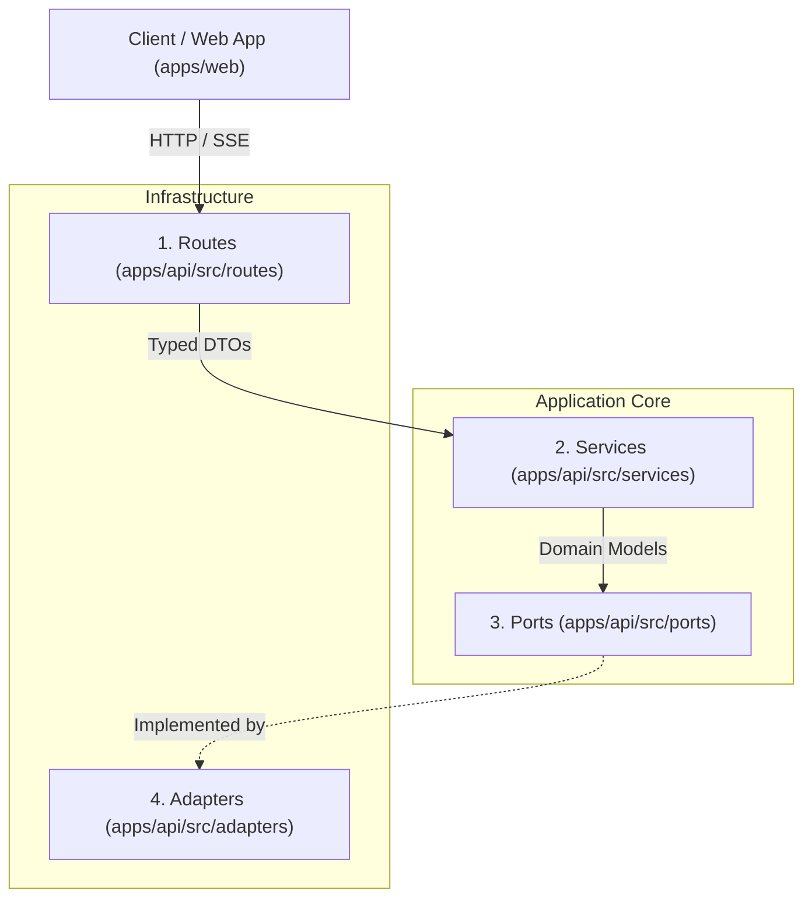

# Backend Architecture & Layering

This document outlines the architectural boundaries and layering for Cirkkl's backend-agnostic migration.

---

## Layering Overview

The backend follows Hexagonal (Ports & Adapters) principles across four distinct layers:

### 1. Routes Layer (`apps/api/src/routes`)
- **Responsibility**: HTTP protocol handling, route matching, request parsing, and input/output validation.
- **Contract Enforcement**: Every route validates incoming query params and bodies against schema definitions from `@cirkkl/contracts`.
- **Identity Invariant**: Route inputs strictly omit identity fields (`userId`, `orgId`). The identity of the caller is resolved exclusively from the authenticated session context provided by auth middleware.
- **Error Mapping**: Service errors and validation failures are mapped to standardized `@cirkkl/contracts` error codes (`BAD_REQUEST`, `UNAUTHORIZED`, `FORBIDDEN`, `NOT_FOUND`, `CONFLICT`, etc.).

### 2. Services Layer (`apps/api/src/services`)
- **Responsibility**: Domain orchestration, business invariants, authorization, and transactional boundaries.
- **Business Logic Examples**:
  - Verifying ticket quota before decrementing and creating a registration.
  - Ensuring user is not already registered in an event before accepting a team invite.
  - Enforcing organization ownership checks prior to updating events or members.
  - Dispatching notification events and realtime broadcasts when registrations are approved or teams are created.
- **Decoupling**: Services never import database libraries, SDKs, or transport protocols directly; they depend exclusively on Port interfaces injected via constructor or dependency injection container.

### 3. Ports Layer (`apps/api/src/ports`)
- **Responsibility**: Abstract interfaces and pure domain entities representing boundaries between application core and external systems.
- **Providers**:
  - `AuthProvider`: Token verification, sign up, login, logout.
  - `StorageProvider`: Generation of upload targets, public URL resolution, asset deletion. Operates strictly on opaque storage keys (e.g. `events/banner-123.jpg`), not full URLs.
  - `RealtimeProvider`: User-scoped message publishing and real-time subscription streaming.
- **Repositories**:
  - `EventRepo`: Event persistence, queries, speaker & role management.
  - `TicketRepo`: Ticket inventory, pricing, and reservation.
  - `RegistrationRepo`: Event registrations, ticket codes, attendee status.
  - `TeamRepo`: Team structures, leaders, and member invite management.
  - `OrganisationRepo`: Organization profiles, verification states, and OTP validation.
  - `MemberRepo`: Organization roster, roles, and department assignments.
  - `NotificationRepo`: User notifications, unread tracking, cleanup.
  - `ProfileRepo`: User profiles, CKL ID resolution, college search.
  - `PaymentRepo`: Order references, UPI transaction tracking, merchant config.

### 4. Adapters Layer (`apps/api/src/adapters`)
- **Responsibility**: Concrete implementations of Ports interacting with external services and storage backends.
- **Examples**:
  - `SupabaseAuthProvider` / `ClerkAuthProvider` / `CustomJwtAuthProvider`
  - `S3StorageProvider` / `CloudflareR2StorageProvider` / `SupabaseStorageProvider`
  - `PostgresEventRepo` / `PrismaEventRepo` / `DrizzleEventRepo`
  - `SseRealtimeProvider` / `RedisPubSubRealtimeProvider`

---

## Architectural Rules & Constraints

1. **Backend Independence**: No code outside the adapter layer may reference vendor-specific SDKs (e.g. Supabase, AWS, Firebase).
2. **Storage Key Storage**: Databases must store asset keys (`profile_image/{uuid}.jpg`) rather than pre-rendered URLs. URLs are resolved on-demand through `StorageProvider.getPublicUrl(key)` or CDN configurations.
3. **Session-Driven Identity**: Calling code cannot supply `userId` or `orgId` in request bodies. Identity is injected by auth middleware into the request context.
4. **Relational PostgREST Translation**: PostgREST embedded joins (such as `teams!inner(...)` and `team_members(...)`) are replaced by explicit repository queries with transactional boundaries.
